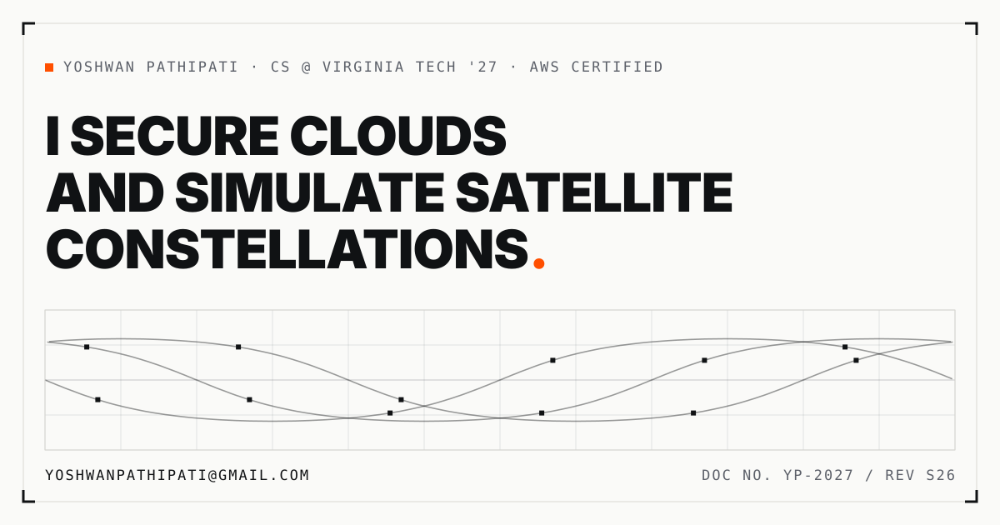

# Yoshwan Pathipati: portfolio

**Live at [yoshwanpathipati.com](https://yoshwanpathipati.com)**

[](https://yoshwanpathipati.com)

My personal site, designed as an engineering dossier: part aerospace flight-test manual, part security
assessment report. The concept, color and type system, and wireframes are written up in
[DESIGN.md](DESIGN.md), which was finished before any component code.

## Stack

- **Next.js 16** (App Router), exported as a fully static site
- **React 19** and **TypeScript** in strict mode
- **Tailwind CSS v4**
- **Vercel** for hosting, with Speed Insights for real-user performance data

No animation library and no UI kit. Every interaction, including the orbital plot in the hero, is written
by hand.

## Project structure

```text
src/
  app/          layout, page, metadata, sitemap, robots, icons
  components/   one file per section (Hero, FieldRecord, Builds, Contact, ...)
  lib/
    content.ts  every word and fact on the site
scripts/
  generate-assets.mjs   builds the social card and favicon set
public/
  og.png, resume.pdf
```

All copy lives in `src/lib/content.ts`. Components render nothing that is not defined there, so the
text can change without touching layout code.

## Running it locally

Requires Node.js 20.9 or newer.

```bash
npm install
npm run dev
```

Then open <http://localhost:3000>.

| Command | What it does |
| --- | --- |
| `npm run dev` | Development server |
| `npm run build` | Static export to `out/` |
| `npm run typecheck` | `tsc --noEmit` |
| `npm run lint` | ESLint |
| `npm run assets` | Regenerates `og.png` and the favicon set |

## Performance and accessibility

Lighthouse, production build:

| | Performance | Accessibility | Best practices | SEO |
| --- | --- | --- | --- | --- |
| Desktop | 100 | 100 | 100 | 100 |
| Mobile | 95 to 97 across 5 runs | 100 | 100 | 100 |

On mobile: FCP 0.9s, **CLS 0**, TBT around 100ms, LCP 2.4 to 2.9s. LCP is dominated by React hydration,
which is the framework's floor for a page this size; disabling the hero canvas entirely was measured and
did not move it.

Two optimisations were tried, measured, and reverted: dropping the mono font's preload (it cost
0.12 CLS, since the labels are load-bearing structure) and building with webpack instead of Turbopack
(no meaningful difference in shipped JavaScript).

Also verified: no horizontal scroll from 320px to 1440px and up, WCAG AA contrast on every text node in
both light and dark themes, and full keyboard navigation with a visible focus ring at every stop.

## Engineering notes

**Fonts are self-hosted** at build time with `next/font` (Archivo, Instrument Sans, IBM Plex Mono). No
font request leaves the page at runtime, and metric-matched fallbacks keep layout shift at zero.

**Type sizes are computed, not eyeballed.** Each `clamp()` floor is set by the longest unbreakable word
in that role, so a headline can never force a horizontal scroll on a 320px screen.

**The page works without JavaScript.** Scroll reveals only hide content when a `data-js` attribute is
set by an inline script, and a `<noscript>` rule unhides everything, so the full document is readable
with scripts blocked. Counters render their final values on the server for the same reason.

**Off-screen sections skip rendering** with `content-visibility: auto`, the single largest first-load
win on a page this tall. Because the size hints are estimates, the nav releases them on the visitor's
first pointer or key event, before any link can be clicked, so anchor links always land in the right
place.

**The social card is generated, not drawn.** `scripts/generate-assets.mjs` rasterises `og.png` with
sharp, so it can be rebuilt with one command whenever the design changes.

## Deployment

Pushes to `master` deploy to production on Vercel, and every pull request gets a preview deployment.
Since the build is a plain static export, `out/` can also be served from any static host. For a host
that serves the site from a subpath (such as a GitHub Pages project site), set `NEXT_PUBLIC_BASE_PATH`
at build time so asset links resolve.

---

Designed and built by Yoshwan Pathipati.
[LinkedIn](https://linkedin.com/in/yoshwan-pathipati-b9b525269) ·
[GitHub](https://github.com/YoshwanPathipati)
